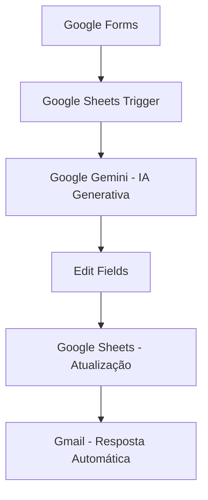

# 🤖 SmartDesk AI — Atendimento Inteligente

## 📖 Sobre o projeto

O SmartDesk AI é uma central de atendimento inteligente desenvolvida para automatizar o recebimento, a classificação e o processamento de solicitações de clientes, utilizando inteligência artificial generativa.

O projeto integra diferentes ferramentas em um único fluxo automatizado, demonstrando a aplicação prática da inteligência artificial na resolução de problemas cotidianos.

## 🎯 Problema identificado

Muitas empresas enfrentam dificuldades na gestão de solicitações de clientes, como:

- Demora no atendimento.
- Classificação manual de solicitações.
- Dificuldade na identificação de prioridades.
- Sobrecarga das equipes de atendimento.
- Tarefas repetitivas.

## 💡 Solução desenvolvida

Uma automação inteligente capaz de analisar solicitações, identificar categorias, definir prioridades, gerar resumos e enviar e-mails personalizados de confirmação de recebimento.

## ⚙️ Arquitetura do projeto

## 🚀 Funcionalidades

- Monitoramento automático de novas solicitações.
- Análise de texto com inteligência artificial.
- Classificação por categoria.
- Identificação do nível de prioridade.
- Geração automática de resumos.
- Atualização do banco de dados.
- Envio de e-mails personalizados.

## 🧠 Classificação inteligente

| Categoria | Prioridade |
|---|---|
| Suporte Técnico | Alta |
| Financeiro | Média |
| Comercial | Baixa |
| Reclamação | |
| Outros | |

As categorias e prioridades são determinadas de forma independente pela inteligência artificial, conforme o conteúdo de cada solicitação.

## 🛠️ Tecnologias utilizadas

- **n8n:** automação e integração de processos.
- **Google Gemini:** inteligência artificial generativa.
- **Google Forms:** coleta de solicitações.
- **Google Sheets:** armazenamento e gerenciamento de informações.
- **Gmail:** envio automatizado de e-mails.
- **JSON:** estruturação e exportação do workflow.
- **GitHub:** documentação e versionamento.

## 📦 Como executar o projeto

1. Baixe o arquivo `smartdesk-ai-workflow-publico.json`.
2. Importe o arquivo na plataforma n8n.
3. Configure suas próprias credenciais.
4. Crie um formulário integrado ao Google Sheets.
5. Configure a planilha e os campos correspondentes.
6. Configure o Google Gemini e o Gmail.
7. Teste e ative o workflow.

## 🔒 Segurança e privacidade

A versão pública do workflow foi preparada para não compartilhar as referências privadas da configuração original. Cada usuário deverá configurar suas próprias integrações.

## 📊 Resultados

O workflow original foi testado com sucesso, incluindo o recebimento do e-mail automatizado.

A solução tem potencial para reduzir atividades manuais, melhorar a organização das solicitações e aumentar a produtividade.

## 📚 Conhecimentos adquiridos

- Inteligência artificial generativa.
- Engenharia de prompt.
- Automação de processos.
- Integração entre aplicações.
- Manipulação de dados JSON.
- Desenvolvimento de workflows.
- Documentação de projetos.
- Versionamento com GitHub.

## 🔮 Melhorias futuras

- Dashboard de indicadores de atendimento.
- Integração com WhatsApp.
- Encaminhamento de solicitações por departamento.
- Notificações para solicitações de alta prioridade.
- Análise de sentimentos.

---

Desenvolvido como projeto educacional e de portfólio profissional, com foco em inteligência artificial generativa e automação de processos.
